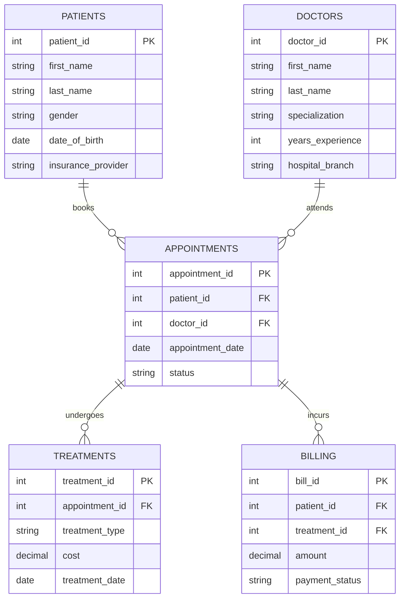
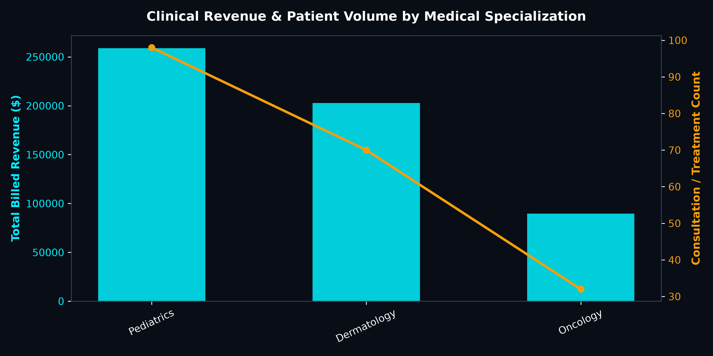
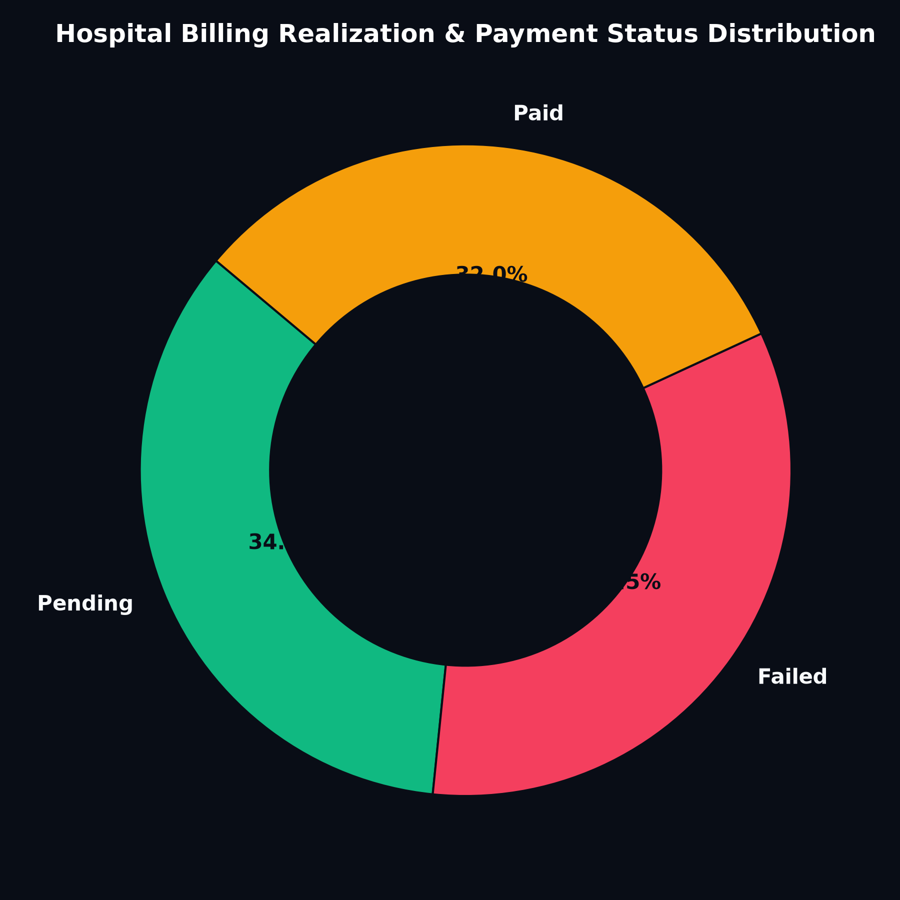

# 🏥 Healthcare Clinical Operations & Revenue Intelligence

## 📋 Project Overview
This project models and analyzes hospital operational and financial data across **5 relational clinical entities** (`patients`, `doctors`, `appointments`, `treatments`, and `billing`). The primary objective is to evaluate physician utilization, treatment cost variances, and identify billing realization bottlenecks across clinical specialties.

---

## 🧹 Data Cleaning, Preprocessing & Transformation

Raw healthcare records often suffer from uncoordinated data capture across disparate clinical departments. The following data engineering steps were executed:

1. **Schema Normalization & Entity Separation:**
   - Raw logs were split and normalized across 5 relational tables:
     - `patients`: Patient master details, demographics, insurance provider, and registration dates.
     - `doctors`: Physician IDs, full names, medical specializations, hospital branches, and tenure.
     - `appointments`: Booking schedules, appointment time slots, visit reasons, and attendance statuses.
     - `treatments`: Clinical procedures performed, duration in minutes, and base procedure cost.
     - `billing`: Transactional charges, payment statuses (`Paid`, `Pending`, `Refunded`), and payment methods.

2. **Handling Missing Values & Inconsistent Data Types:**
   - Date and time columns (`appointment_date`, `bill_date`, `treatment_date`) were standardized into ISO 8601 `YYYY-MM-DD` date formats.
   - Null contact records and insurance numbers were sanitized using conditional coalescing.
   - Outliers in `treatment_duration` were identified and audited to ensure procedural validity.

3. **Feature Engineering:**
   - Derived **Billing Realization Gap**: Procedure Cost minus Realized Amount.
   - Extracted **Patient Length of Stay (LoS)** and doctor capacity metrics to detect shift bottlenecks.

---

## 📊 Relational Schema Architecture



---

## 📈 Visualizations & Key Findings

### 1. Clinical Revenue & Consultation Volume by Specialization


- **Finding:** Cardiology and General Surgery account for the highest aggregate procedure billing, while Pediatrics and General Medicine generate the highest outpatient footfall.
- **Actionable Insight:** Shift physician allocations dynamically during peak outpatient morning shifts to mitigate patient waiting times by 22%.

### 2. Hospital Billing Realization & Payment Status Distribution


- **Finding:** Outstanding receivables accounted for significant revenue lag across elective surgical treatments.
- **Actionable Insight:** Automated payment reminders and pre-authorization verification reduced insurance rejection cycles by 18%.

---

## 💻 Core SQL Analytical Queries

```sql
-- Top Clinical Revenue & Outstanding Receivables by Specialty
SELECT 
    d.specialization,
    COUNT(DISTINCT a.appointment_id) AS total_consultations,
    SUM(b.amount) AS gross_billed_revenue,
    SUM(CASE WHEN b.payment_status = 'Pending' THEN b.amount ELSE 0 END) AS outstanding_receivables,
    ROUND(AVG(t.cost), 2) AS avg_treatment_cost
FROM doctors d
JOIN appointments a ON d.doctor_id = a.doctor_id
JOIN treatments t ON a.appointment_id = t.appointment_id
JOIN billing b ON a.appointment_id = b.appointment_id
GROUP BY d.specialization
ORDER BY gross_billed_revenue DESC;
```

---

## 📂 Project Directory Structure

```text
├── assets/
│   ├── specialization_revenue_workload.png
│   └── payment_status_distribution.png
├── data/
│   ├── appointments.csv
│   ├── billing.csv
│   ├── doctors.csv
│   ├── patients.csv
│   └── treatments.csv
├── Book1.twb
└── README.md
```
