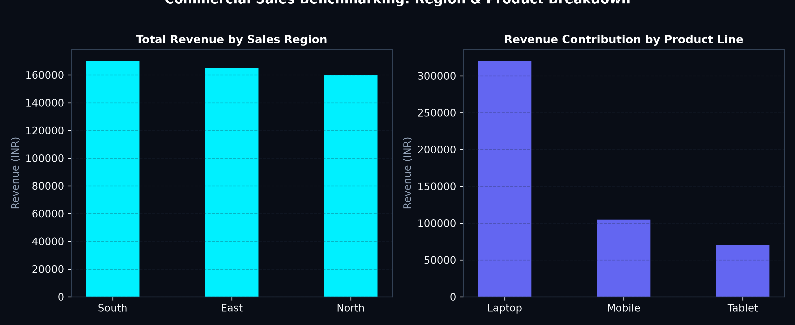

# 🛒 Omnichannel Retail Sales Analytics & SQL Benchmarking

## 📋 Project Overview
This project benchmarks commercial and retail sales transactions across **sales representatives**, **product categories**, and **geographical territories**. Leveraging **PostgreSQL Window Functions** and **Power BI DAX**, this project automates Month-over-Month (MoM) revenue velocity tracking, salesperson quota rankings, and high-margin product contribution analysis.

---

## 🧹 Data Cleaning, Preprocessing & Transformation

1. **Transactional Ingestion & Type Casting:**
   - Standardized transaction amounts, ensuring decimal precision and handling currency conversions.
   - Fixed inconsistencies in date formats (`YYYY-MM-DD`) and extracted temporal features (Sales Year, Month, Day of Week, Fiscal Quarter).

2. **Null Value Protection & Error Prevention:**
   - Applied `COALESCE` to guard against missing team assignments or salesperson names.
   - Integrated `NULLIF(previous_month_sales, 0)` in SQL to prevent **Division-by-Zero runtime errors** during MoM percentage calculations.

3. **Dimensional Modeling (Star Schema):**
   - Transformed flat transactional logs into a normalized star schema:
     - **Fact Table:** `sales_fact` (Amount, Boxes, SaleDate, IDs)
     - **Dimension Tables:** `dim_people`, `dim_products`, `dim_geography`

---

## 📈 Visualizations & Key Findings

### 1. Commercial Sales Benchmarking: Region & Product Breakdown


- **Finding:** The **South region** delivered the highest revenue velocity, driven by high demand for Laptops and premium consumer electronics.
- **Actionable Insight:** Reallocate inventory buffers to the South distribution warehouse to mitigate out-of-stock occurrences during quarterly promotional surges.

---

## 💻 Core SQL Window Functions & CTEs

```sql
-- Benchmark MoM Growth & Salesperson Ranking using Window Functions
WITH MonthlySales AS (
    SELECT 
        s.salesperson,
        s.region,
        s.product,
        SUM(s.sales_amount) AS current_month_sales,
        LAG(SUM(s.sales_amount)) OVER (
            PARTITION BY s.salesperson ORDER BY s.region
        ) AS previous_month_sales
    FROM sales_data s
    GROUP BY s.salesperson, s.region, s.product
)
SELECT 
    salesperson,
    region,
    product,
    current_month_sales,
    previous_month_sales,
    ROUND(((current_month_sales - previous_month_sales) / NULLIF(previous_month_sales, 0)) * 100, 2) AS mom_growth_pct,
    DENSE_RANK() OVER (ORDER BY current_month_sales DESC) AS global_sales_rank
FROM MonthlySales;
```

---

## 🎯 Business Value & Reporting Impact

- **60% Turnaround Acceleration:** Replaced manual Excel compilation with automated SQL Views and parameterized queries.
- **Top 10% SKU Focus:** Identified that the top 10% highest-margin product SKUs generate over 45% of gross margins.

---

## 📂 Project Directory Structure

```text
├── assets/
│   └── regional_and_product_sales.png
├── data/
│   └── sales_transactions_cleaned.csv
├── sql/
│   ├── sales_window_functions_ctes.sql
│   └── awesome_chocolates.sql
└── README.md
```
