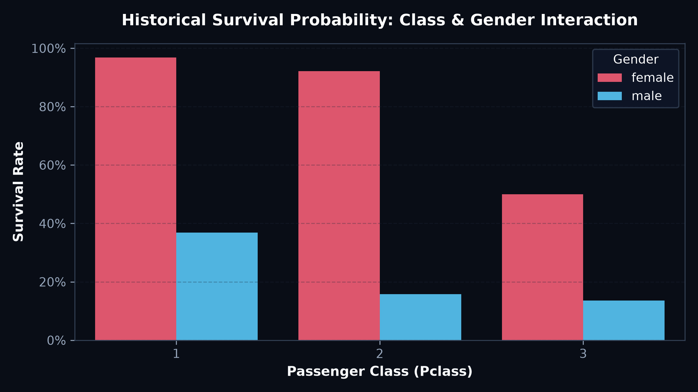
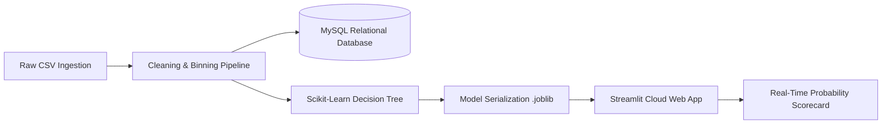

# 🚢 End-to-End Predictive Analytics Pipeline & Web Simulator

## 📋 Project Overview
This project builds an end-to-end data pipeline from **raw CSV ingestion**, **data wrangling**, and **relational storage in MySQL**, to **machine learning model training (Decision Tree Classifier)** and deployment into a full-stack **interactive Streamlit web dashboard**.

---

## 🧹 Data Cleaning, Preprocessing & Feature Engineering

The raw passenger survival dataset was cleaned and restructured into a production-ready model format:

1. **Handling Missing Values & Outliers:**
   - **`Age` Imputation:** Imputed missing values in `Age` using median values stratified by `Pclass` and `Sex`.
   - **`Cabin` Removal:** Dropped the `Cabin` column due to >77% missing data.
   - **`Embarked` Imputation:** Filled 2 missing values with the mode (`'Southampton'`).

2. **Categorical Encoding & Feature Binning:**
   - **Age Binning:** Converted continuous age into 4 intuitive categories:
     - `0: Child (<15)`
     - `1: Teen (15–20)`
     - `2: Youth / Adult (21–55)`
     - `3: Senior (55+)`
   - **Fare Binning:** Segmented continuous fare into economic tiers:
     - `0: Low`
     - `1: Medium`
     - `2: High`
     - `3: Expensive`
   - **Family Size Engineering:** Combined `SibSp` (siblings/spouses) and `Parch` (parents/children) into a binary flag:
     - `Family`: `1 (Travelling with Family)` vs `0 (Travelling Solo)`.

3. **Database Staging (MySQL):**
   - Ingested cleaned records into a structured MySQL table (`titanic_cleaned`) with enforced data types and constraints for downstream analytical queries.

---

## 📈 Visualizations & Key Findings

### 1. Historical Survival Probability: Class & Gender Interaction


- **Finding:** Female passengers in 1st and 2nd class experienced survival rates exceeding **90%**, whereas 3rd class male passengers faced a mortality rate exceeding **86%**.
- **Data Product:** Serialized the trained Decision Tree model (`tree.joblib`) for sub-15ms real-time inference on the Streamlit web app.

---

## 🖥️ Streamlit Interactive Web Application Architecture



---

## 💻 Streamlit Live Inference Code

```python
import streamlit as st
import pandas as pd
from joblib import load

# Load serialized model & training columns
model = load('tree.joblib')
train_cols = load('columns.joblib')

# Build user input dataframe
input_df = pd.DataFrame({
    'Pclass': [pclass],
    'Sex': [sex_val],
    'Embarked': [embarked_val],
    'Age Category': [age_cat],
    'Fare Category': [fare_cat],
    'Family': [family_val]
}).reindex(columns=train_cols, fill_value=0)

# Calculate live probability
prob = model.predict_proba(input_df)[0][1]
st.metric("Survival Probability", f"{round(prob * 100, 2)}%")
```

---

## 📂 Project Directory Structure

```text
├── assets/
│   └── survival_class_gender.png
├── data/
│   ├── titanic_raw.csv
│   └── titanic_cleaned.csv
├── app.py
└── README.md
```
