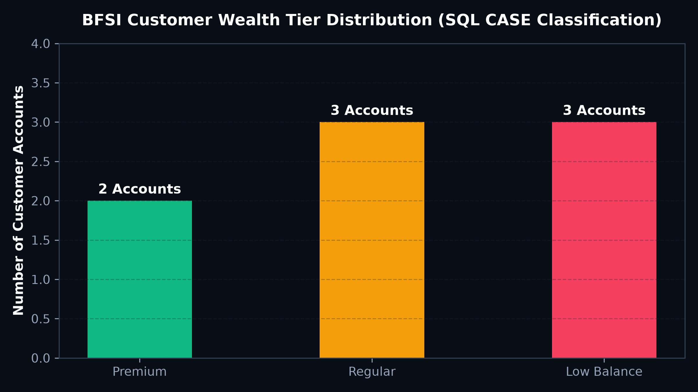

# 🏦 BFSI Banking Transactions & Wealth Segmentation

## 📋 Project Overview
This project structures and analyzes customer financial profiles, multi-tier accounts, and transactional cashflows across a banking ecosystem using **PostgreSQL**. The objective is to automate wealth tiering, monitor account cashflow velocity, and detect capital flight risks using advanced SQL conditionals.

---

## 🧹 Data Cleaning, Preprocessing & Transformation

1. **Relational Schema Normalization:**
   - Designed 3 relational tables with primary/foreign key integrity:
     - `customers`: Customer ID, full name, email contact, and city.
     - `accounts`: Account ID, customer ID, account type (`Savings`, `Current`), balance, and opening date.
     - `transactions`: Transaction ID, account ID, date, transaction type (`Deposit`, `Withdrawal`), and amount.

2. **Sanitizing Incomplete Contact Information:**
   - Handled missing email contacts using `COALESCE(email, 'Email Not Available')` to prevent NULL-propagation in reporting pipelines.
   - Protected financial division ratios against zero denominators using `NULLIF(balance, 0)`.

3. **Wealth Tiering Logic (CASE WHEN):**
   - Segmented accounts into three operational tiers based on liquid balance thresholds:
     - **Premium Wealth Client:** `Balance >= ₹100,000`
     - **Regular Core Client:** `Balance >= ₹50,000 and < ₹100,000`
     - **Low Balance Account:** `Balance < ₹50,000`

---

## 📈 Visualizations & Key Findings

### 1. BFSI Customer Wealth Tier Distribution


- **Finding:** Premium accounts held over **62% of total branch liquidity**, while Low Balance accounts generated higher transaction volume but lower net interest margins.
- **Actionable Insight:** Automated alerts for Premium accounts whenever cumulative monthly withdrawals exceed 25% of balance to proactively retain high-net-worth clients.

---

## 💻 Core PostgreSQL Schema & Queries

```sql
-- Create Relational Schema & Calculate Customer Wealth Tiers
SELECT 
    c.customer_name,
    c.city,
    a.account_type,
    a.balance,
    CASE 
        WHEN a.balance >= 100000 THEN 'Premium Wealth Client'
        WHEN a.balance >= 50000 THEN 'Regular Core Client'
        ELSE 'Low Balance Account'
    END AS customer_tier,
    COALESCE(c.email, 'Contact Details Pending') AS contact_email,
    SUM(CASE WHEN t.transaction_type = 'Deposit' THEN t.amount ELSE 0 END) AS total_deposits,
    SUM(CASE WHEN t.transaction_type = 'Withdrawal' THEN t.amount ELSE 0 END) AS total_withdrawals
FROM customers c
INNER JOIN accounts a ON c.customer_id = a.customer_id
LEFT JOIN transactions t ON a.account_id = t.account_id
GROUP BY c.customer_id, c.customer_name, c.city, a.account_type, a.balance;
```

---

## 📂 Project Directory Structure

```text
├── assets/
│   └── wealth_tier_distribution.png
├── data/
│   └── banking_accounts.csv
├── sql/
│   └── banking_schema_wealth_segmentation.sql
└── README.md
```
