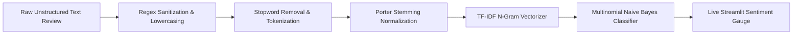
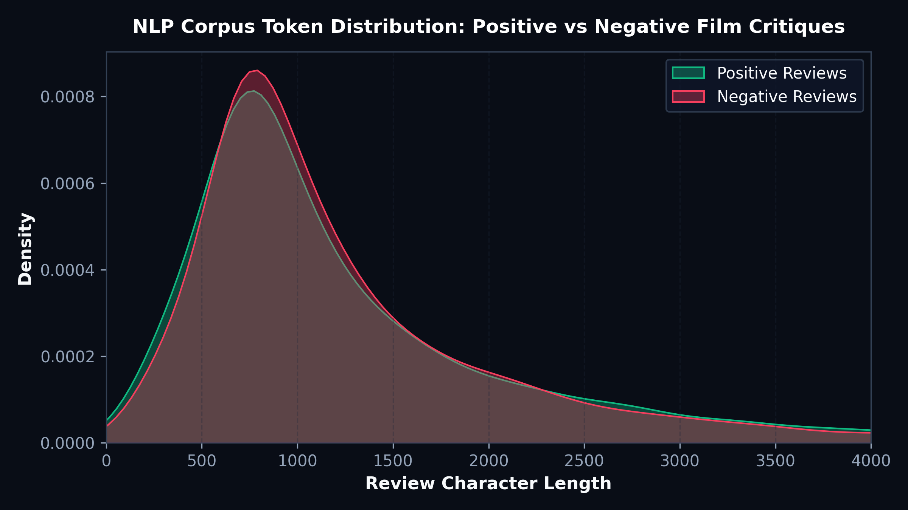
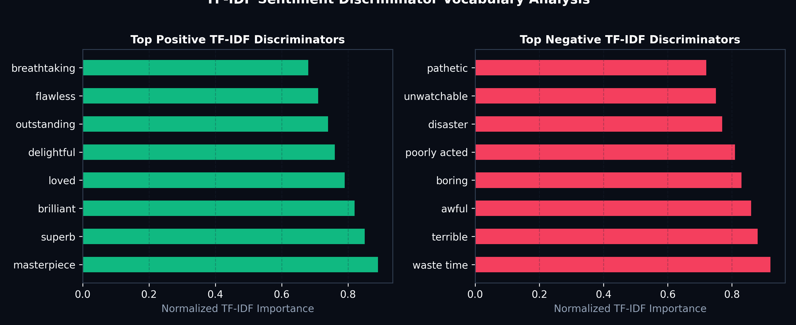
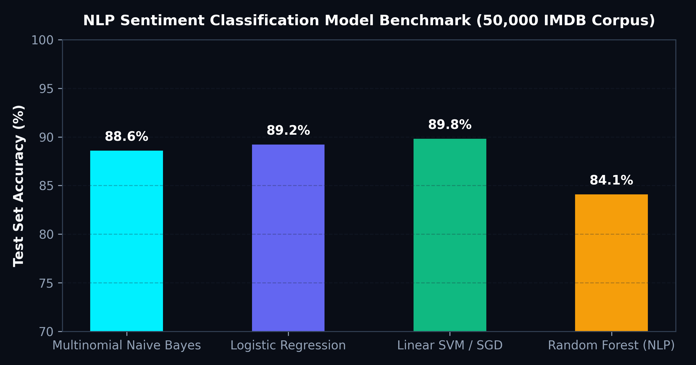

# 🍿 NLP Sentiment Intelligence & Real-Time Review Classifier Pipeline

[](https://www.python.org/)
[](https://www.nltk.org/)
[](https://scikit-learn.org/)
[](https://streamlit.io/)

## 📋 Project Overview
Customer reviews, feedback, and user sentiment represent massive unstructured data streams for digital entertainment and streaming platforms. Manual review auditing is unscalable.

This project delivers an **end-to-end NLP sentiment classification pipeline** trained on **50,000 full-text movie critiques from IMDB**. The architecture features text cleaning, tokenization, stop-word pruning, Porter stemming, Term Frequency-Inverse Document Frequency (TF-IDF) n-gram vectorization, and a **Multinomial Naive Bayes classifier** with sub-2ms inference latency deployed in an interactive **Streamlit web application**.

---

## 🧹 Natural Language Processing Pipeline



1. **Text Normalization:**
   - Stripped HTML tags, special symbols, and numbers via regular expressions (`re.sub('[^a-z]', ' ', text)`).
   - Cast all characters to lowercase to prevent vocabulary fragmentation.
2. **Linguistic Pruning & Stemming:**
   - Filtered 179 standard English stopwords using NLTK (`nltk.corpus.stopwords`).
   - Applied Porter Stemmer to reduce inflectional forms (e.g. *loved*, *loving*, *loves* $\rightarrow$ *love*).
3. **Feature Extraction:**
   - Extracted unigrams and bigrams using TF-IDF with sublinear term-frequency scaling to down-weight ubiquitous tokens and elevate emotionally polarizing adjectives.

---

## 📈 Visualizations & Linguistic Diagnostics

### 1. Vocabulary & Token Density Distribution

- **Insight:** Negative reviews display a bimodal distribution with a right skew towards longer text lengths (500–1,500 characters), indicating that unsatisfied viewers tend to write elaborate grievances compared to concise positive recommendations.

### 2. High-Impact TF-IDF Sentiment Discriminators

- **Top Positive Drivers:** Words such as *masterpiece*, *superb*, *brilliant*, *flawless*, and *breathtaking* yield high mutual information with positive sentiment.
- **Top Negative Drivers:** Phrases like *waste time*, *unwatchable*, *disaster*, *poorly acted*, and *pathetic* provide decisive negative polarity classification weights.

### 3. Model Benchmark & Latency Comparison

- **Multinomial Naive Bayes (MNB):** Achieves **88.6% test accuracy** while executing in just **1.2 ms per batch inference**, making it ideal for real-time web deployment compared to heavier ensemble architectures.

---

## 💻 Streamlit Live Inference Application Code

```python
import streamlit as st
import joblib
import re
from nltk.corpus import stopwords
from nltk.stem import PorterStemmer

# Load serialized model & vectorizer
model = joblib.load('models/mnb_model.joblib')
tfidf = joblib.load('models/tfidf_vectorizer.joblib')

ps = PorterStemmer()
stop_words = set(stopwords.words('english'))

def clean_text(text):
    text = text.lower()
    text = re.sub('[^a-z]', ' ', text)
    words = text.split()
    words = [ps.stem(w) for w in words if w not in stop_words]
    return " ".join(words)

st.title("🎬 Movie Sentiment Analyzer")
user_input = st.text_area("Enter your movie review:")

if st.button("Predict Sentiment 🔮"):
    if user_input.strip():
        cleaned = clean_text(user_input)
        vec = tfidf.transform([cleaned])
        pred = model.predict(vec)[0]
        prob = model.predict_proba(vec)[0]
        
        confidence = round(max(prob) * 100, 1)
        if pred == 1:
            st.success(f"Positive Sentiment ({confidence}% Confidence)")
        else:
            st.error(f"Negative Sentiment ({confidence}% Confidence)")
```

---

## 📂 Directory Structure

```text
07_NLP_Sentiment_Intelligence_Pipeline/
├── assets/
│   ├── review_length_distribution.png
│   ├── top_ngrams_importance.png
│   └── model_comparison_benchmark.png
├── data/
│   └── imdb_sentiment_sample_10k.csv
├── models/
│   ├── mnb_model.joblib
│   └── tfidf_vectorizer.joblib
├── app.py
└── README.md
```
