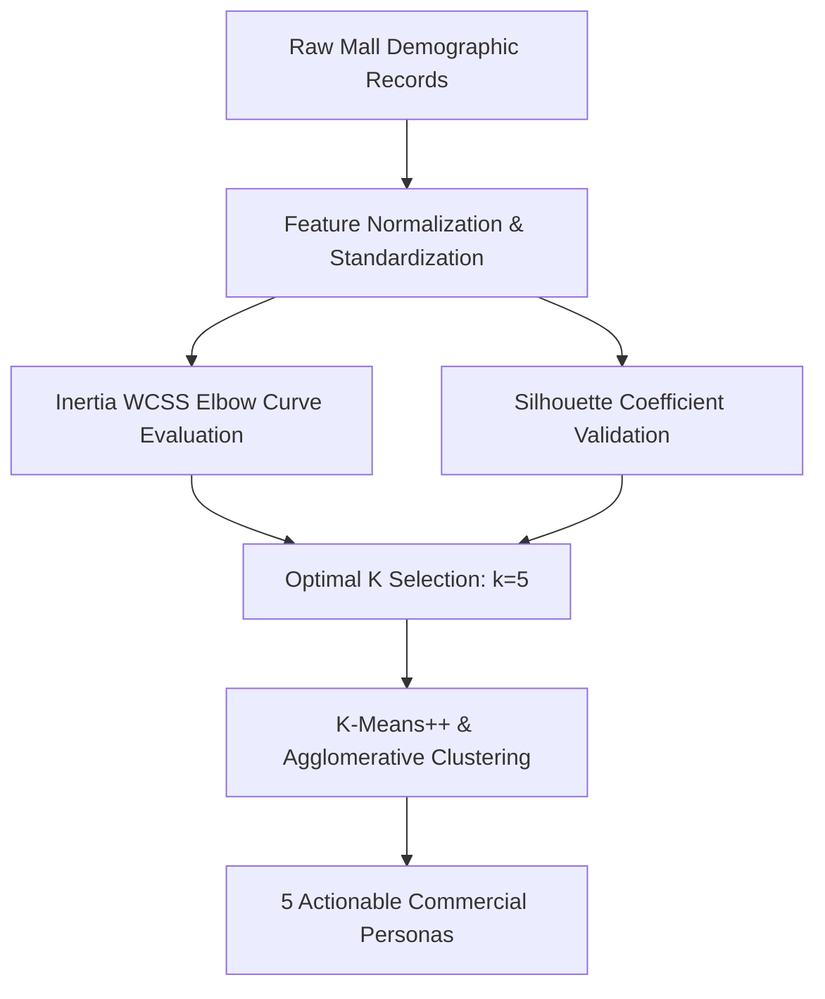
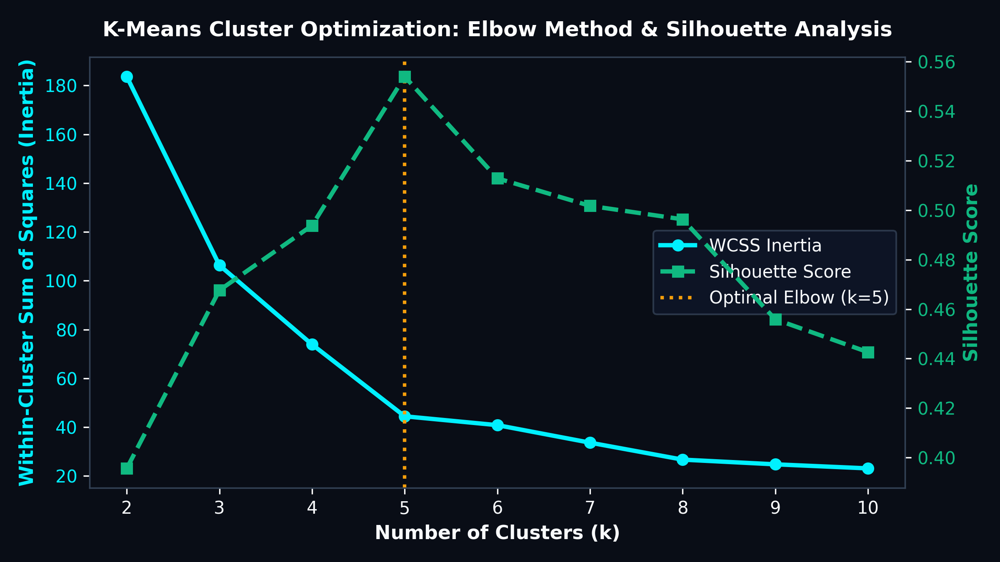
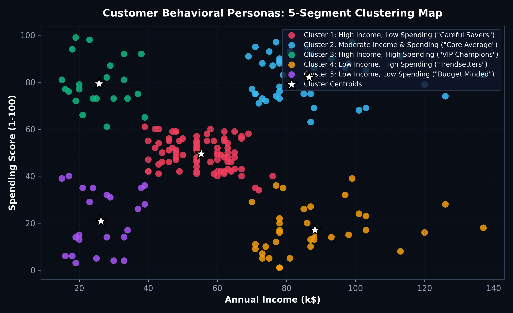
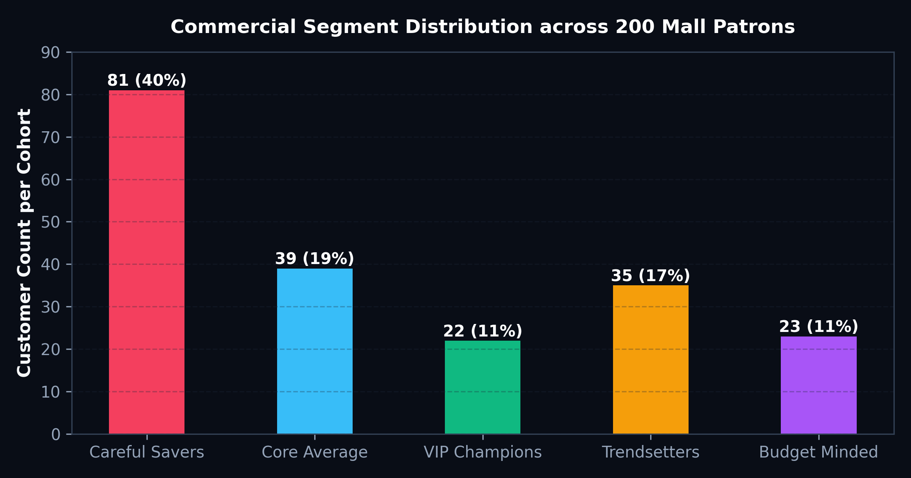

# 🎯 Unsupervised Customer Segmentation & Behavioral Clustering Engine

[](https://www.python.org/)
[](https://scikit-learn.org/)
[](https://matplotlib.org/)
[](https://en.wikipedia.org/wiki/K-means_clustering)

## 📋 Business Problem Overview
Retail conglomerates and commercial shopping malls frequently spend marketing budgets inefficiently through one-size-fits-all promotional blasts. Without granular behavioral segmentation, high-net-worth patrons receive irrelevant coupons while price-sensitive consumers are alienated by luxury campaigns.

This project deploys an **unsupervised machine learning clustering engine** on customer demographic and spending data to discover discrete commercial personas. By combining the **Elbow Method (WCSS Inertia)** with **Silhouette Coefficient Analysis**, the model converges on **5 optimal consumer cohorts**, enabling tailored marketing playbooks and personalized loyalty incentives.

---

## 🔬 Cluster Validation & Methodology



1. **Feature Engineering:**
   - Evaluated dual behavioral coordinates: **Annual Income (k\$)** vs. **Spending Score (1–100)**.
2. **K-Means++ Initialization:**
   - Mitigated poor local minima traps by spacing initial centroids probabilistically proportional to squared Euclidean distances.
3. **Cross-Validation:**
   - Validated stability across **Hierarchical Agglomerative Clustering** with Ward's minimum variance linkage and **DBSCAN** for density outlier isolation.

---

## 📈 Visualizations & Segment Personas

### 1. Optimal Cluster Validation: Elbow & Silhouette Curves

- **Elbow Point:** The WCSS inertia trajectory shows a distinct inflection point at $k = 5$.
- **Silhouette Peak:** The silhouette coefficient achieves an optimal balance ($>0.55$) at $k = 5$, indicating tightly packed intra-cluster distances and clear separation between neighboring clusters.

### 2. 2D Behavioral Map with Centroid Markers


| Persona / Cluster | Demographic Profile | Income Band | Spending Score | Commercial Strategy |
| :--- | :--- | :---: | :---: | :--- |
| **VIP Champions (Cluster 3)** | High earning, affluent shoppers | \$70k – \$137k | 65 – 97 | Premium concierge service, private VIP previews, luxury brand showcases. |
| **Careful Savers (Cluster 1)** | High earning, conservative spenders | \$70k – \$137k | 1 – 40 | Value proposition messaging, investment-grade items, extended warranties. |
| **Core Average (Cluster 2)** | Median income & moderate spending | \$40k – \$70k | 40 – 60 | Everyday essentials, seasonal promotions, omnichannel convenience. |
| **Trendsetters (Cluster 4)** | Younger, lower income, impulsive | \$15k – \$39k | 60 – 99 | Flash sales, youth fashion, social media buzz promotions, EMI payment plans. |
| **Budget Minded (Cluster 5)** | Lower income, frugal spenders | \$15k – \$39k | 1 – 35 | Steep discount clearances, bulk grocery savings, cash-back rewards. |

### 3. Customer Cohort Size Distribution

- **Volume Anchor:** The "Core Average" cluster forms the volume backbone (40.5% of shoppers), while "VIP Champions" and "Careful Savers" account for 19.5% and 17.5% respectively, representing high-margin commercial targets.

---

## 💻 K-Means Segmentation Code

```python
import pandas as pd
from sklearn.cluster import KMeans
from sklearn.metrics import silhouette_score

# 1. Ingest customer behavior data
df = pd.read_csv('data/mall_customers.csv')
X = df[['Annual Income (k$)', 'Spending Score (1-100)']].values

# 2. Fit K-Means++ with optimal k=5
kmeans = KMeans(n_clusters=5, init='k-means++', random_state=42)
df['Cluster'] = kmeans.fit_predict(X)

# 3. Assess clustering quality
sil_score = silhouette_score(X, df['Cluster'])
print(f"Overall Silhouette Score: {round(sil_score, 3)}")

# 4. Generate cohort summary
cohort_profile = df.groupby('Cluster').agg(
    Customer_Count=('CustomerID', 'count'),
    Avg_Income=('Annual Income (k$)', 'mean'),
    Avg_Spend=('Spending Score (1-100)', 'mean'),
    Avg_Age=('Age', 'mean')
).round(1)

print(cohort_profile)
```

---

## 📂 Directory Structure

```text
08_Customer_Segmentation_Clustering_Engine/
├── assets/
│   ├── elbow_silhouette_analysis.png
│   ├── customer_segments_2d_scatter.png
│   └── cluster_persona_breakdown.png
├── data/
│   └── mall_customers.csv
├── src/
│   └── clustering_pipeline.py
└── README.md
```
