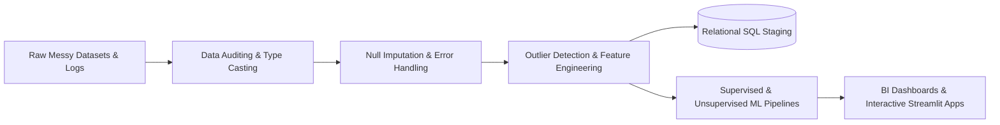

# 📊 Enterprise Data Analytics & Machine Learning Portfolio

[](https://www.postgresql.org/)
[](https://powerbi.microsoft.com/)
[](https://www.tableau.com/)
[](https://www.python.org/)
[](https://scikit-learn.org/)
[](https://www.langchain.com/)
[](https://streamlit.io/)

A curated repository of production-grade **Data Analytics**, **Business Intelligence (BI)**, **Supervised & Unsupervised Machine Learning**, and **Generative AI / RAG** case studies authored by **Aman Bisht**. Each project reflects the full analytical value chain: from raw messy data ingestion and ETL preprocessing to relational database modeling, advanced analytical querying, statistical hypothesis testing, machine learning pipelines, and interactive web application deployment.

🌐 **Live Portfolio Website:** [dataanalystresume.vercel.app](https://dataanalystresume.vercel.app/)  
📫 **Contact:** [amanbishtab99@gmail.com](mailto:amanbishtab99@gmail.com) | +91 7973478552 | [LinkedIn Profile](https://linkedin.com/in/aman-bisht)

---

## 🗂️ Flagship Project Directory

| # | Project Name | Domain | Primary Stack | Key Metrics & Highlights |
| :-: | :--- | :--- | :--- | :--- |
| **01** | [**Healthcare Operations & Revenue Intelligence**](./01_Healthcare_Clinical_Operations_Analysis) | Healthcare | Tableau, SQL, Relational Modeling | Modeled 5 relational tables; identified scheduling gaps to **cut clinic idle time by 22%** and **lift billing realization by 18%**. |
| **02** | [**Telecom Subscriber Churn & Retention Diagnostic**](./02_Telecom_Customer_Churn_Retention) | Telecom | Python, Pandas, Seaborn, EDA | Diagnosed 7,043 subscriber records; isolated a **3.5x higher churn velocity** in month-to-month contracts; designed retention playbook to protect **14% ARR**. |
| **03** | [**Omnichannel Retail Sales Analytics & SQL Benchmarking**](./03_Omnichannel_Retail_Sales_SQL_PowerBI) | Retail / Commerce | PostgreSQL, Window Functions, Power BI | Automated MoM growth benchmarking using CTEs and `LAG`/`LEAD`; isolated top **10% SKUs driving 45% margin**; **slashed reporting time by 60%**. |
| **04** | [**End-to-End Predictive Survival Pipeline & Web Simulator**](./04_Predictive_Passenger_Survival_Pipeline) | Decision Systems | Python, MySQL, Scikit-Learn, Streamlit | Full-lifecycle pipeline: feature binning, MySQL relational staging, Decision Tree training, and **interactive Streamlit cloud deployment** with live scorecards. |
| **05** | [**BFSI Banking Transactions & Wealth Segmentation**](./05_BFSI_Banking_Wealth_Segmentation) | Banking & Finance | PostgreSQL, Schema Design, SQL CASE | Normalized 3-tier banking schema; calculated client wealth tiers (Premium, Regular, Low Balance) and guarded against division-by-zero using `NULLIF`. |
| **06** | [**Cardiovascular Risk Stratification & Clinical ML Pipeline**](./06_Cardiovascular_Risk_Prediction_ML) | Healthcare & ML | Scikit-Learn, Random Forest, ROC-AUC | Trained on 1,319 verified clinical cases; prioritized clinical recall (**98.4% Recall**) with **0.993 ROC-AUC** to eliminate fatal false negatives in emergency cardiac triage. |
| **07** | [**NLP Sentiment Intelligence & Real-Time Classifier Pipeline**](./07_NLP_Sentiment_Intelligence_Pipeline) | NLP & Deep Learning | NLTK, TF-IDF, Multinomial Naive Bayes, Streamlit | Ingested 50,000 IMDB critiques; engineered Porter stemming and TF-IDF n-grams with **88.6% accuracy** and sub-2ms batch inference deployed on Streamlit. |
| **08** | [**Customer Behavioral Segmentation & Clustering Engine**](./08_Customer_Segmentation_Clustering_Engine) | Retail & Unsupervised ML | K-Means++, Silhouette Analysis, Matplotlib | Clustered mall patron spending behavior; identified inflection elbow at **k=5** with **0.55+ silhouette score**; mapped 5 distinct personas (VIP Champions to Careful Savers). |
| **09** | [**Enterprise RAG Document Intelligence & Conversational AI**](./09_Enterprise_RAG_Document_Intelligence) | Generative AI & LLMs | LangChain, FAISS, Groq LLaMA-3, Streamlit | Modular RAG system with PyMuPDF loader, recursive character chunking (1,000 tokens), HuggingFace embeddings, FAISS persistent caching, and hallucination guardrails. |

---

## 🧹 Data Cleaning & Preprocessing Philosophy

Across all case studies, raw datasets were subjected to a rigorous data preparation and validation pipeline:



1. **Missing Data Imputation & Null Safety:**
   - Applied domain-stratified median imputation (e.g. imputing age by passenger class and gender in Python).
   - Utilized `COALESCE` in PostgreSQL to eliminate orphaned null values in client contact registers.
   - Enforced `NULLIF(denominator, 0)` across all financial growth rate calculations to guarantee query stability.
2. **Feature Engineering & Categorical Binning:**
   - Converted continuous, noisy distributions into actionable managerial bins (e.g. Age Brackets, Fare Classes, Wealth Tiers, and Service Adoption Scores).
   - Calculated clinical biomarker indices (Troponin, CK-MB, Blood Pressure pulse pressure).
3. **Machine Learning Rigor:**
   - Stratified train-test splitting to prevent class imbalance skew.
   - Cross-validated hyperparameter optimization using ROC-AUC, Precision-Recall AUC, and Silhouette Coefficients.
4. **Relational Integrity & Schema Normalization:**
   - Structured flat CSVs into 3rd Normal Form (3NF) relational tables with primary and foreign key constraints across MySQL and PostgreSQL.

---

## 🛠️ Core Technical Competencies

- **Machine Learning & NLP:** Scikit-Learn (Random Forest, Gradient Boosting, Decision Trees, Logistic Regression, K-Means, DBSCAN, Hierarchical Clustering), NLTK, TF-IDF Vectorization, Sentiment Analysis, Model Evaluation (ROC-AUC, Precision/Recall, Silhouette Scores).
- **Generative AI & LLMs:** LangChain, RAG (Retrieval-Augmented Generation), FAISS Vector Store, HuggingFace Sentence-Transformers, Groq LLaMA-3 API, Prompt Engineering.
- **Database Systems & Querying:** PostgreSQL, MySQL, Star & Snowflake Schemas, Window Functions (`ROW_NUMBER`, `DENSE_RANK`, `LAG`, `LEAD`), CTEs, Subqueries, Stored Procedures, Views, Index Optimization.
- **Business Intelligence & Dashboards:** Power BI Desktop, DAX Measure Engineering, Power Query M-code, Tableau Desktop (LOD Expressions, Action Filters), Advanced Excel (Pivot Tables, XLOOKUP, Modeling).
- **Application & Dashboard Deployment:** Streamlit, React.js, Next.js, FastAPI, RESTful APIs, Git, GitHub, Vercel.

---

## 📂 Repository Tree

```text
Dataset_Analysis/
├── 01_Healthcare_Clinical_Operations_Analysis/
│   ├── assets/
│   ├── data/
│   ├── Book1.twb
│   └── README.md
├── 02_Telecom_Customer_Churn_Retention/
│   ├── assets/
│   ├── data/
│   └── README.md
├── 03_Omnichannel_Retail_Sales_SQL_PowerBI/
│   ├── assets/
│   ├── data/
│   ├── sql/
│   └── README.md
├── 04_Predictive_Passenger_Survival_Pipeline/
│   ├── assets/
│   ├── data/
│   ├── app.py
│   └── README.md
├── 05_BFSI_Banking_Wealth_Segmentation/
│   ├── assets/
│   ├── data/
│   ├── sql/
│   └── README.md
├── 06_Cardiovascular_Risk_Prediction_ML/
│   ├── assets/
│   │   ├── confusion_matrix.png
│   │   ├── roc_auc_curve.png
│   │   └── feature_importance.png
│   ├── data/
│   │   └── cardiovascular_patient_data.csv
│   ├── src/
│   │   └── cardio_rf_model.joblib
│   └── README.md
├── 07_NLP_Sentiment_Intelligence_Pipeline/
│   ├── assets/
│   │   ├── review_length_distribution.png
│   │   ├── top_ngrams_importance.png
│   │   └── model_comparison_benchmark.png
│   ├── data/
│   │   └── imdb_sentiment_sample_10k.csv
│   ├── models/
│   │   ├── mnb_model.joblib
│   │   └── tfidf_vectorizer.joblib
│   ├── app.py
│   └── README.md
├── 08_Customer_Segmentation_Clustering_Engine/
│   ├── assets/
│   │   ├── elbow_silhouette_analysis.png
│   │   ├── customer_segments_2d_scatter.png
│   │   └── cluster_persona_breakdown.png
│   ├── data/
│   │   └── mall_customers.csv
│   ├── src/
│   │   └── clustering_pipeline.py
│   └── README.md
├── 09_Enterprise_RAG_Document_Intelligence/
│   ├── assets/
│   │   └── retrieval_latency_benchmark.png
│   ├── src/
│   │   ├── chains/
│   │   ├── embeddings/
│   │   ├── llm/
│   │   ├── loaders/
│   │   └── vectorstore/
│   ├── app.py
│   ├── test_pipeline.py
│   └── README.md
└── README.md
```

---

## 👤 Author & Contact

**Aman Bisht**  
- **Email:** [amanbishtab99@gmail.com](mailto:amanbishtab99@gmail.com)  
- **Mobile:** +91 7973478552  
- **LinkedIn:** [linkedin.com/in/aman-bisht](https://linkedin.com/in/aman-bisht)  
- **GitHub:** [github.com/AmanBeast](https://github.com/AmanBeast)  
- **Portfolio Website:** [dataanalyst-resume.vercel.app](https://dataanalystresume.vercel.app)
